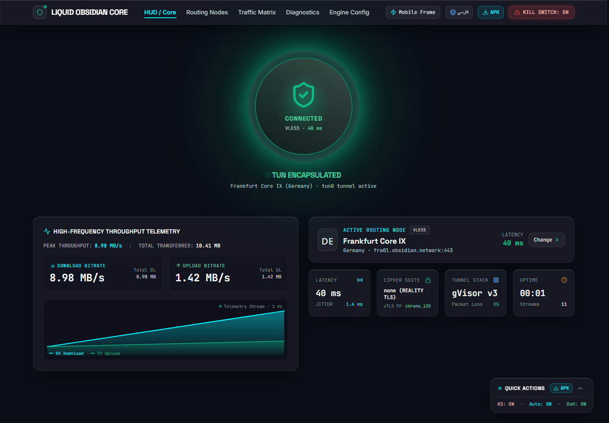
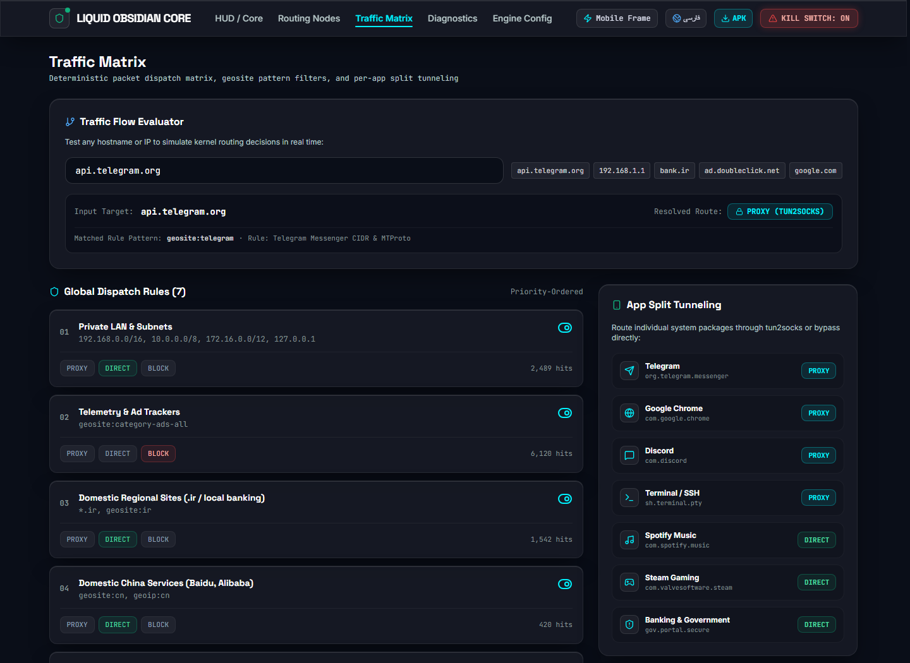
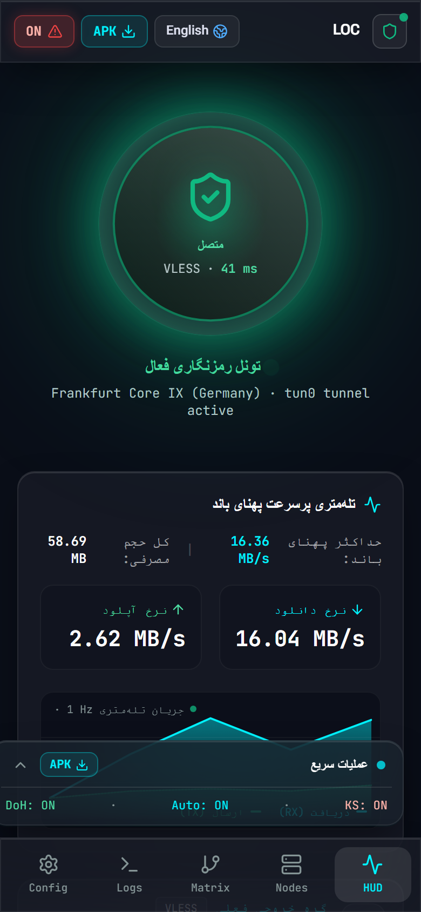

# Liquid Obsidian Core

A networking-client **interface concept** — routing matrix, per-app split tunneling, live throughput
telemetry and DNS-over-HTTPS controls — built with React 19, TypeScript, Vite 8 and Tailwind CSS v4.

> **Honest status:** this repository is a *front-end prototype*. Every speed, ping, connection and log
> line is simulated in the browser. A signed, installable Android APK is provided, but it wraps this
> interface only — there is no TUN device and no proxy core yet. See
> [docs/BUILD-ANDROID.md](docs/BUILD-ANDROID.md) for the native work required, and
> [docs/CODE_REVIEW.md](docs/CODE_REVIEW.md) for the full audit and roadmap.



| Traffic matrix | Persian mobile HUD |
| --- | --- |
|  |  |

## Features

- **Liquid-glass HUD** — tactile connection orb with connected/connecting/disconnecting states.
- **Throughput telemetry** — 1 Hz sampling, SVG waveform, peak and session totals.
- **Routing matrix** — ordered dispatch rules with a live evaluator that understands CIDR blocks,
  `*.wildcard` domains, domain suffixes, `geosite:` / `geoip:` categories and a `FINAL` catch-all.
- **Per-app split tunneling** — per-package proxy/direct switches.
- **Node manager** — search, protocol filters, favourites, batch ping, and share-link import for
  `vless://`, `vmess://` (base64 JSON), `trojan://`, `hysteria2://`, `ss://` (SIP002) and `wireguard://`.
- **Diagnostics** — leak-audit panel, socket table and a filterable kernel log console.
- **Bilingual UI** — full English/Persian switching with document-level RTL.
- **Session persistence** — settings, favourites, imported nodes, locale and active tab survive reload.
- **Android APK** — signed universal build (`release/`), one file for every CPU architecture, API 24+.
- **Deploy-ready** — SPA fallback configs for Vercel, Netlify, GitHub Pages, Docker and a local server.

## Quick start

```bash
# Node 20.19+ (24 LTS recommended — see .nvmrc)
npm ci
npm run dev          # http://127.0.0.1:3000
```

Production build and local serving:

```bash
npm run build
npm start            # http://127.0.0.1:8080  (PORT=... to change)
```

## Android APK

| | |
| --- | --- |
| File | [`release/LiquidObsidian-1.0.0-universal.apk`](release/LiquidObsidian-1.0.0-universal.apk) (165 KB) |
| Package | `com.obsidian.core` — versionCode 1, versionName 1.0.0 |
| Requirements | Android 7.0+ (API 24), targetSdk 35 |
| Architecture | **Universal** — `arm64-v8a`, `armeabi-v7a`, `x86`, `x86_64` (the app contains no native code, so one APK covers every device) |
| Signature | APK Signature Scheme v2 + v3, RSA-4096 |
| SHA-256 | see [`release/SHA256SUMS.txt`](release/SHA256SUMS.txt) |

Install by side-loading: copy the APK to the device, allow *Install unknown apps* for your file
manager, open the file and accept the prompt. The launcher icon is generated from
`public/favicon.svg`.

The app loads the web bundle from a synthetic `https://app.local` origin (intercepted inside the
WebView) because Chromium refuses ES modules over `file://` — this also keeps `localStorage`
working normally.

Rebuild it yourself:

```bash
npm ci
npm run build:android    # bundle with relative asset paths → dist-android/
npm run apk              # Gradle wrapper build → release/
```

`npm run apk` needs JDK 17+ and `ANDROID_HOME`; see [android/README.md](android/README.md) for
signing and CI details. CI builds the APK on every `v*` tag
([`.github/workflows/android-apk.yml`](.github/workflows/android-apk.yml)).

## Scripts

| Script | What it does |
| --- | --- |
| `npm run dev` | Vite dev server with HMR on port 3000 |
| `npm run build` | Type-safe production bundle into `dist/` |
| `npm start` | Zero-dependency static server with SPA fallback |
| `npm run preview` | Vite's own preview server on 4173 |
| `npm run typecheck` | `tsc --noEmit` in strict mode |
| `npm test` | Node test runner (`network-core` unit suite) |
| `npm run build:android` | Production bundle with relative paths for the WebView |
| `npm run apk` | Builds + signs the Android APK into `release/` |
| `npm run clean` | Removes `dist/` |

## Project structure

```
src/
  App.tsx                    shell state, routing, connect flow, persistence
  components/                HUD, nodes, matrix, diagnostics, settings, modals
  data/mock-nodes.ts         seed nodes, rules, app routes, logs
  types/index.ts             domain types
  utils/network-core.ts      formatting, rule engine, share-link parser, i18n
  utils/use-dialog.ts        focus trap / Escape / scroll lock for modals
  utils/network-core.test.ts unit tests
android/                     WebView shell (Gradle project, no native libs)
  app/src/main/java/…        MainActivity + asset interception
  app/src/main/res/          launcher icons, theme
release/                     signed APK + SHA256SUMS.txt
docs/
  BUILD-ANDROID.md           WebView shell vs. a real VpnService client
  CODE_REVIEW.md             audit: findings, fixes, roadmap (Persian)
scripts/
  serve.mjs                  dependency-free production static server
  build-apk.mjs              web bundle → Gradle → release/
```

## Deployment

The app is a static SPA — any static host works. `BASE_PATH` controls the asset base when the app is
served from a sub-path.

### Vercel

[](https://vercel.com/new/clone?repository-url=https://github.com/armin7270/my-tipstopnetwor-app)

`vercel.json` already contains the SPA rewrite, cache and security headers. Or from the CLI:

```bash
npm i -g vercel
vercel --prod
```

### Netlify

[](https://app.netlify.com/start/deploy?repository=https://github.com/armin7270/my-tipstopnetwor-app)

`netlify.toml` pins Node 24, sets `dist` as the publish directory and adds the SPA redirect.

### GitHub Pages

Enable **Settings → Pages → Source: GitHub Actions**. The bundled workflow
[`.github/workflows/deploy-pages.yml`](.github/workflows/deploy-pages.yml) builds with
`BASE_PATH=/<repo>/`, copies `index.html` to `404.html` for deep links and publishes `dist`.

### Docker

```bash
docker build -t liquid-obsidian-core .
docker run --rm -p 8080:80 liquid-obsidian-core
```

### Any VPS / static server

```bash
npm ci && npm run build
node scripts/serve.mjs        # or point nginx at dist/ using deploy/nginx.conf
```

## Configuration

There are **no required environment variables** and no API keys — the prototype never calls a remote
service. `.env.example` is a leftover from the AI Studio template and is not read by the app.

| Variable | Default | Purpose |
| --- | --- | --- |
| `PORT` | `8080` | Port for `npm start` |
| `BASE_PATH` | `/` | Asset base for sub-path hosting |
| `DISABLE_HMR` | – | Disables HMR/file watching (AI Studio compatibility) |

URL parameters: `?autostart=1` boots connected, `?tab=nodes` (or `#nodes`) deep-links a screen.

## Verification

The production build was smoke-tested in headless Chrome at 1440×1000 and 390×844:

- zero console errors and zero uncaught exceptions;
- rule evaluator resolves `bank.ir → DIRECT`, `ad.doubleclick.net → BLOCK`, `chatgpt.com → geosite:openai`;
- locale, tab and settings persist across reloads;
- no horizontal overflow at 390 px;
- modals open, lock scroll, trap focus and close on Escape.

```bash
npm run typecheck && npm test && npm run build
```

## Known limitations

- Simulated telemetry — no real traffic, no proxy engine.
- No APK binaries; the "Android Build Hub" produces a build manifest instead.
- No authentication, no backend, no cloud sync.
- Rule engine ships a small offline subset of `geosite`/`geoip` categories instead of the full databases.
- Persian translation covers navigation and primary controls; deeper screens remain English.

See [docs/CODE_REVIEW.md](docs/CODE_REVIEW.md) for the complete list and priorities.

## License

[MIT](LICENSE)
